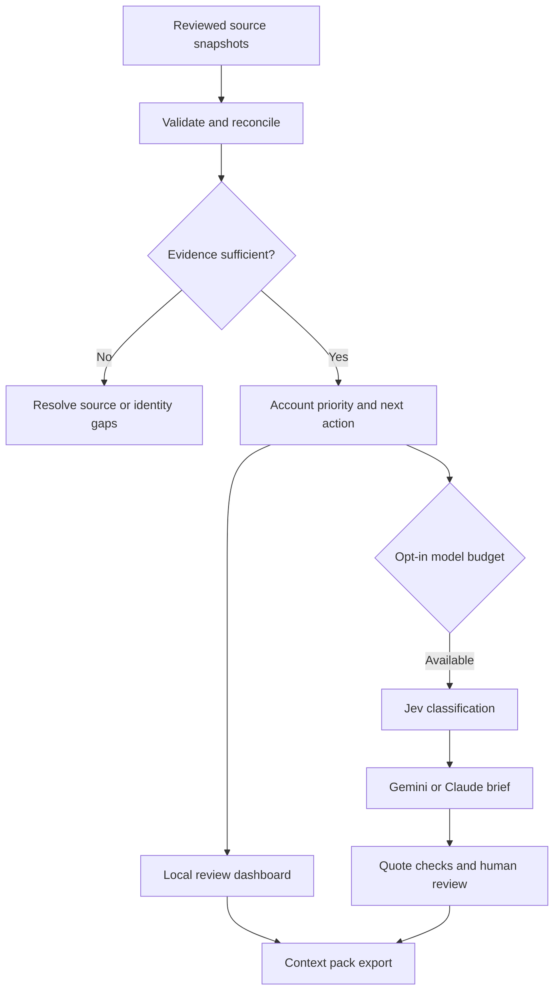

# Architecture and strategy

## Business question

Which account needs attention, why, who is involved, and what evidence should shape the next step? Reconciliation happens before generation so an attractive draft cannot hide stale or contradictory data.

## Deterministic rules

Account priority sums editable industry, company-size, recent-inbound and overdue-commitment weights. It is not a purchase probability. Source completeness/freshness and blocking conditions decide whether drafting is eligible independently of that score.

Decision precedence: identity conflict → all contacts suppressed → incomplete/stale source coverage → questionable commitment evidence → overdue commitment → future meeting → agreed future step → latest inbound with/without later outbound → research. Every source event has a `source:id` evidence key. Identical replays deduplicate; conflicting replays quarantine. Exact email or canonical LinkedIn identities shared by different contact IDs require review; no fuzzy matching is performed.

Commitments are operator-confirmed structured data. The engine checks evidence existence, contact identity and timing, but cannot prove semantic fulfillment. Bookings require a meeting ID and start time; later matching cancellations remove them from preparation. Opt-out keyword detection supplements explicit `doNotContact` and `opt_out` fields; it is conservative and not a full language understanding system.

Buying-role gaps only use explicitly confirmed roles. Keyword topic counts help a marketer find candidate content themes; negation and nuance require review. Asset recommendations remain briefs. An implementation question may suggest an implementation outline, a cost question a cost-assumptions sheet, and a proof request an approved case study. No fabricated customer results or personalised media are generated.

## Model strategy

Use a strong model while developing the two versioned skills: define the objective, source requirements, output schema, examples and failure cases. Evaluate revised instructions against fixtures. Use deterministic code for reconciliation and smaller configured models for suitable live briefs. Escalate ambiguous cases to a human or explicitly selected Claude run. Skills are reusable instructions, not transferred model intelligence.

Claude does not autonomously own credentials, invoke arbitrary tools or send messages. The code controls what can run and records estimated usage. This makes model changes reviewable without giving source-message text control over actions.

## Production extension points

Add authenticated users, account-level permissions, durable encrypted storage, provider token refresh, incremental sync with cursor watermarks, a background queue, idempotent writes and a tamper-evident audit trail before shared enterprise deployment. Any future sender should re-check opt-outs, latest messages, meeting state and recipient approval at send time. Exported `sendAllowed:false` is a boundary, not an executable sending authorisation.

The proposed second project, Adaptive Follow-up Studio, would consume reviewed packs for media and multichannel follow-up. It is not part of this repository.
